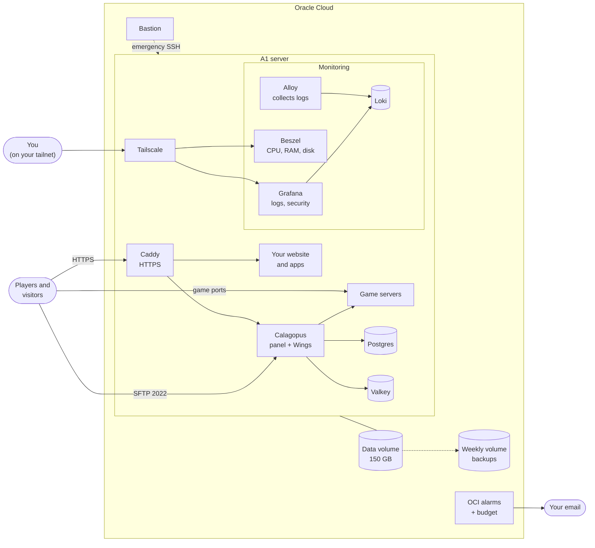

# Calagopus game server on Oracle Cloud

This repo sets up a game server panel ([Calagopus](https://calagopus.com)) on one free Oracle
Cloud server. The same server can also host your website and small web apps.

- **Terraform** (`oci/`) creates the cloud parts: network, server, disk, backups and alerts.
- **Ansible** (`ansible/`) sets up the server: security, Docker, the panel, websites and monitoring.
- **`deploy.sh`** runs both.

The goals are: stay free, stay secure, and always know what the server is doing.

Status, plans and decisions are in [PLAN.md](PLAN.md). For how and why everything works,
including every quirk, read the [design guide](docs/GUIDE.md).

## How it fits together



- **The public** can reach only three things: websites over HTTPS (the panel, your blog, your
  apps), file upload to game servers (SFTP on port 2022) and the game ports.
- **You** reach SSH and the dashboards only through [Tailscale](https://tailscale.com), a private
  network between your own devices. None of it is open to the internet.
- **All data** (worlds, database, logs) lives on the 150 GB data volume, not on the system disk.
- **Oracle watches the server from outside** and emails you if it goes down, runs out of memory,
  or starts costing money.

## What runs on the server

| Part | What it does |
| :--- | :--- |
| Calagopus panel + Wings | The web panel and the agent that runs game servers. One container ("all-in-one"). |
| Postgres, Valkey | The panel's database and cache. They can't reach the internet. |
| Caddy | Gets HTTPS certificates and sends each hostname to the right place: the panel, your website or an app. Logs every request. |
| Beszel | CPU, memory, disk and network graphs per server and per container. Sends alerts. |
| Loki + Alloy | Alloy collects all logs, Loki keeps them for 30 days. |
| Grafana | Searches the logs, live or past. Has a ready-made "Security overview" dashboard. |
| Socket proxy | Lets the monitoring tools read Docker info, but not change anything. |

## Cost: it stays free

You're on Pay As You Go, so Oracle bills anything above the free amounts instead of blocking it.
Everything here fits inside them:

| Resource | Used | Free amount |
| :--- | :--- | :--- |
| A1 server | 1 server, 4 OCPU / 24 GB, always on | 4 OCPU / 24 GB on PAYG accounts¹ |
| Disk | 50 GB system + 150 GB data = 200 GB | 200 GB, home region only |
| Volume backups | Weekly, kept 3 weeks (at most 4) | 5 in total, system disk and data disk together |
| Alert emails | At most ~360 a month, even if both alarms fire all month | 1,000 a month |
| Monitoring | Server metrics + 2 alarms | Far below the free amount |
| Traffic out | Players + panel | 10 TB a month |
| Bastion, budget, network, public IP | — | No charge |

¹ Since June 2026, Oracle's [docs](https://docs.oracle.com/en-us/iaas/Content/FreeTier/freetier_topic-Always_Free_Resources.htm)
list 2 OCPU / 12 GB for Always Free–only accounts. Oracle support says PAYG accounts keep 4/24.
Terraform refuses to create anything bigger than 4/24.

The `free-tier-guard` budget (`oci/budget.tf`) emails you at the first real charge.

Things that **would** cost money:

- More than 5 volume backups at once. Manual backups count too.
- Disks created outside your home region.
- Leftover system disks from deleted servers. They still count toward the 200 GB.
- More than 10 GB in Object Storage (Standard tier).

## Security

- **Admin access is private.** SSH and the dashboards work only over Tailscale. Public SSH is
  closed after the first setup. If Tailscale breaks, use OCI Bastion.
- **Nobody can take over a fresh panel.** Ansible creates the first admin and closes the setup
  wizard *before* the panel goes online. Registration is off, admins must use two-factor login,
  and telemetry is off. Ansible re-applies these settings on every run.
- **Passwords stay out of sight.** They live in an encrypted Ansible vault on your machine. On
  the server they are files, not environment variables, so `docker inspect` doesn't show them.
- **Containers have only the access they need.** Image versions are pinned, so nothing updates
  by surprise. Containers can't gain extra privileges. The database has no internet access.
  Game servers can't reach Oracle's internal metadata service.
- **The server updates itself.** Ubuntu, Docker and Tailscale security updates install
  automatically. If an update needs a reboot, it happens at 05:30.
- **Known trade-off:** the panel container controls Docker, so a panel admin is effectively root
  on the server. That's why admins must use two-factor login.

## Websites and apps

All websites are listed in one place: `sites:` in `ansible/group_vars/all/vars.yml`. Each entry
is a hostname plus **one** of these:

| Type | Use it for | Example |
| :--- | :--- | :--- |
| `static` | A folder of files, like an Astro blog | `{ host: "example.com", static: blog }` |
| `proxy` | An app container, or a game server's web page | `{ host: "app.example.com", proxy: "myapp:3000" }` |
| `redirect` | Sending a hostname elsewhere | `{ host: "www.example.com", redirect: "https://example.com" }` |

Caddy gets an HTTPS certificate for each hostname by itself. For that to work, the hostname's DNS
must point at the server first.

### Add your blog (static site)

1. **DNS:** point `example.com` (and `www`) at the server's public IP with `A` records. Remove
   any old records for them (for example GitHub Pages).
2. **vars.yml:** add the site (the example file already has these two lines):
   ```yaml
   sites:
     - { host: "{{ domain_name }}", static: blog }
     - { host: "www.{{ domain_name }}", redirect: "https://{{ domain_name }}" }
   ```
3. **Apply:** `./deploy.sh configure --tags web`
4. **Publish:** build the site, then upload it. Run this again every time you change the blog:
   ```bash
   npm run build
   scripts/publish-site.sh blog ./dist
   ```
   The upload goes over Tailscale and mirrors the folder: files you deleted locally are deleted
   on the server too. If the site has a `404.html`, Caddy uses it for missing pages.

### Add a web app

1. Copy `apps/example/` to `apps/<name>/` and edit `compose.yml`. The comments in the example
   explain the rules: join the `web` network, publish no ports, pin the image, keep data under
   `/mnt/data/apps/<name>/`, and set a memory limit.
2. Add the folder name to `apps:` in `vars.yml`, and add a site that points at it:
   ```yaml
   apps: [myapp]
   sites:
     - { host: "app.{{ domain_name }}", proxy: "myapp:3000" }   # <service name>:<port>
   ```
3. **Secrets (optional):** add them to the vault and load them in the app with
   `env_file: [secrets.env]`:
   ```yaml
   vault_app_env:
     myapp: { DATABASE_PASSWORD: "..." }
   ```
4. Point the hostname's DNS at the server, then run `./deploy.sh configure --tags web`.

**To remove an app:** take it out of `apps:` and `sites:`, then on the server run
`docker compose down` in `/opt/stacks/apps/<name>` and delete that folder.

Keep apps small: the game servers need the CPU and memory more. Light apps (a forum like Flarum
or NodeBB, a small API) are fine. For a shop that takes payments, a hosted store (for example
Tebex) is much safer than running payment code yourself.

### Show a game server's web page (Dynmap, BlueMap)

Map plugins run a small web server inside the game server. To put it behind HTTPS:

1. In the panel, add an allocation with IP **`172.18.0.1`** and a free port, for example 25501.
   Assign it to the game server and set the plugin to use that port. `172.18.0.1` keeps the port
   private: only Caddy can reach it, not the internet.
2. Add a site: `{ host: "survival.minecraft.{{ domain_name }}", proxy: "172.18.0.1:25501" }`
3. Point the DNS at the server and run `./deploy.sh configure --tags web`.

The same hostname can serve the map in a browser *and* the game. Players join
`survival.minecraft.example.com` with the game's own port. With an `SRV` DNS record they don't
even need to type the port.

### DNS tips

- **One record per hostname** works fine. Each one gets its own certificate.
- **Wildcards save work:** an `A` record for `*.example.com` (or `*.minecraft.example.com`)
  covers every name under it. Caddy still only answers for hostnames listed in `sites:`.
- **Certificates are public.** Every hostname with a certificate shows up in public certificate
  logs. Don't rely on a hostname staying secret.

## Backups

There are three layers. Each one solves a different problem:

| Layer | What it saves | How often | Where | Use it when |
| :--- | :--- | :--- | :--- | :--- |
| **Volume backup** (set up) | The whole data volume: all worlds, the panel database, logs | Weekly (Mon 04:00 UTC), kept 3 weeks | Oracle, outside the server | The disk is lost or everything is broken |
| **Calagopus backups** (you set up) | One game server's files | As often as you schedule | The data volume (default) | One world needs to go back in time |
| **Database dump** (planned) | The panel's database | Nightly | The data volume | The panel's data is damaged |

How they work together:

- **Restore one world:** use Calagopus. It takes a click in the panel and affects nothing else.
- **Restore the whole server:** use the volume backup. Everything goes back to that Monday:
  every world, every account and every Calagopus backup.
- **Calagopus backups are stored on the data volume by default.** So the weekly volume backup
  includes them. But if the data volume itself is lost, those backups are lost with it. You then
  fall back to the latest volume backup, which can be up to 7 days old.
- **A volume backup is like pulling the plug.** The database recovers fine. A world that was
  being saved at that exact moment may be damaged. That's why per-world Calagopus backups matter.
- **Backups take space on the data volume.** Set retention limits in Calagopus, for example
  "keep 3 daily, 2 weekly". Set a disk alert in Beszel too (for example at 80 %).
- **Everything stays inside your Oracle account.** To be safe against losing the account, keep
  an extra copy elsewhere. You can download important worlds now and then, or later add Object
  Storage as a Calagopus backup target (planned in PLAN.md; free up to 10 GB Standard).
- **Keep the encryption key safe.** The panel database is encrypted with
  `vault_calagopus_encryption_key`. Without it, a restored database is useless. Keep the key in
  a password manager, separate from the backups.

To set up Calagopus backups, go to Admin → Storage → **System Backup Policies** and create a
policy:

- **Kind:** Server.
- **Backup Configuration:** "Integrated Backup Configuration" (created by the panel; stores on the data disk).
- **Schedule:** daily.
- **Retention:** for example keep 3 daily and 2 weekly.
- **Coverage:** add the Integrated Node, so every game server is covered.

## Before you start

1. **Tools.** Run `nix develop` to get Terraform, Ansible, ansible-lint, shellcheck and oci-cli.
   Terraform's licence keeps it out of nix's binary cache, so nix compiles it, which takes a few
   minutes. Run this once, and again after `nix flake update`, so nix's garbage collector keeps
   the build instead of deleting it:

   ```bash
   nix develop --profile .direnv/flake-profile -c true
   ```
2. **Oracle.**
   - An API key in `oci/api_key.pem`.
   - `oci/terraform.tfvars` with `user_ocid`, `fingerprint`, `tenancy_ocid`, `region`,
     `compartment_ocid` and `notification_email`.
   - An SSH key in `~/.ssh/id_ed25519` (or set `SSH_KEY`).
3. **Tailscale** (admin console):
   - Turn on **MagicDNS** and **HTTPS Certificates** on the DNS page.
   - **Services → Advertise → Define a Service**, twice. The dashboards are published under
     these names (set in `group_vars/all/network.yml`):

     | Name | Endpoint | Becomes |
     | :--- | :--- | :--- |
     | `logs` | `tcp:443` | `https://logs.<tailnet>.ts.net` (Grafana) |
     | `status` | `tcp:443` | `https://status.<tailnet>.ts.net` (Beszel) |

   - **Access controls:** own the server's tag, let it publish the two services without manual
     approval, and allow only yourself in:
     ```jsonc
     "tagOwners": { "tag:gameserver": ["autogroup:admin"] },
     "autoApprovers": {
       "services": { "svc:logs": ["tag:gameserver"], "svc:status": ["tag:gameserver"] }
     },
     "grants": [
       { "src": ["autogroup:admin"], "dst": ["svc:logs", "svc:status"], "ip": ["443"] },
       { "src": ["autogroup:admin"], "dst": ["tag:gameserver"], "ip": ["tcp:22"] }
     ]
     ```
   - Remove the default "allow everything" rule if it's still there (only if your other
     devices don't depend on it).
   - Create an auth key: not reusable, pre-approved, tag `tag:gameserver`.
4. **DNS.** Point an `A` record for `panel.<your domain>` at the server's public IP
   (`terraform -chdir=oci output public_ip`). Do the same for each website (see
   [Websites and apps](#websites-and-apps)).

## First deployment

```bash
cp ansible/group_vars/all/vars.yml.example ansible/group_vars/all/vars.yml
```

Edit `vars.yml`: your domain, email addresses and websites. Then:

```bash
scripts/init-vault.sh
```

This creates all passwords and asks for the Tailscale auth key.

```bash
./deploy.sh infra
```

This shows what Terraform will change and asks before applying. Oracle then emails you to
confirm the alert subscription: **confirm it**, or you won't get alerts.

```bash
./deploy.sh bootstrap
```

This opens SSH to your IP, sets up the server, then closes SSH again.

After that:

1. **Log in** at `https://panel.<your domain>` as `admin`. Get the password with:
   ```bash
   ansible-vault view --vault-password-file ansible/.vault_pass ansible/group_vars/all/vault.yml
   ```
   The panel will ask you to set up two-factor login first.
2. **Add game ports:** Admin → Nodes → Integrated Node → Allocations. Use IP `0.0.0.0` and ports
   from 25500 to 25600. Only that range is open.
3. **Add egg repositories** (game templates) and create your game servers.
4. **Set up backups** (see [Backups](#backups)).
5. **Set up alerts in Beszel:** add a notification URL, for example a Discord webhook.
6. **Save the vault password and the encryption key** in a password manager.

## Dashboards

Open these from a device on your tailnet:

| Address | What |
| :--- | :--- |
| `https://logs.<tailnet>.ts.net` | Grafana: logs (live and past) and the Security overview |
| `https://status.<tailnet>.ts.net` | Beszel: health and alerts |

These are Tailscale Services: private names on your tailnet, no port to remember. The names
are `grafana_service_name` / `beszel_service_name` in `ansible/group_vars/all/network.yml`.

## Everyday tasks

Run the whole setup again (safe to repeat):

```bash
./deploy.sh configure
```

Update only the panel:

```bash
./deploy.sh configure --tags calagopus
```

Update only websites, apps and Caddy:

```bash
./deploy.sh configure --tags web
```

Publish the blog after a change:

```bash
scripts/publish-site.sh blog ./dist
```

Preview changes without applying them:

```bash
./deploy.sh configure --check --diff
```

- **Update the panel or monitoring:** change the version and digest in
  `ansible/group_vars/all/images.yml`. That file shows how to look up the digest. Then run the
  matching `--tags`. Read the [panel release notes](https://calagopus.com/docs/releases/panel) first.
- **Update one of your apps:** change the image in `apps/<name>/compose.yml`, then
  `--tags web`.
- **Change panel settings** like registration or two-factor login in `calagopus_settings`
  (`ansible/roles/calagopus/defaults/main.yml`). Changes made in the panel UI get reverted.
- **Tailscale is down:** in the Oracle console, open Bastion and start a "managed SSH session" to
  the server's private IP (`terraform -chdir=oci output private_ip`).
- **Change the database password:** first run `ALTER ROLE panel PASSWORD '...'` in the `db`
  container, then change it in the vault.

## When something goes wrong

| Problem | What to check |
| :--- | :--- |
| A site shows a certificate error | Its DNS doesn't point at the server yet, or ports 80/443 are blocked. Check Caddy's log in Grafana (`{container="web-caddy-1"}`). Let's Encrypt allows only a few failed tries per hour, so set `acme_staging: true` while testing. |
| A site says "502 Bad Gateway" | The app behind it isn't running or listens on another port. Check `docker ps` and the app's log in Grafana. |
| The playbook stops at "Require MagicDNS + HTTPS certificates" | Turn on HTTPS Certificates on the Tailscale DNS page. |
| The playbook stops at "Publishing a Tailscale Service failed" | Define the `logs` and `status` services in the Tailscale console and add them to `autoApprovers` (see Before you start). |
| `https://logs.…` doesn't load | The service is waiting for approval (Tailscale console → Services), or your policy has no grant for it. |
| `https://logs.…` resolves but times out, after you defined or renamed a service in the console | Tailscale hasn't noticed that the server serves it. On the server, run `sudo tailscale serve --service=svc:logs --https=443 off` (same for `status`), then re-run `./deploy.sh configure --tags tailscale`. |
| You can't SSH in | Tailscale is down on the server or on your device. Use OCI Bastion (see Everyday tasks). |
| Beszel shows the server as "pending" | Normal for the first minute after a restart. |
| The disk is filling up | Check Beszel. Usual causes: game backups (lower the retention) or a very chatty log. |
| An email says money was charged | Open Billing → Cost Analysis in Oracle and see the table in [Cost](#cost-it-stays-free). |

## Files

```
oci/                      Terraform: network, server, disk, backups, budget, alarms
ansible/site.yml          The playbook: runs the roles below, in order
ansible/roles/
  base/                   Packages, SSH hardening, automatic updates
  storage/                Formats and mounts the data volume
  docker/                 Docker, plus the shared "web" network
  firewall/               Small additions to Oracle's firewall rules
  tailscale/              Private admin access and the dashboard addresses
  calagopus/              The game panel, its database and cache
  web/                    Caddy: the panel, your websites and your apps
  observability/          Beszel, Grafana, Loki, Alloy
ansible/group_vars/all/   vars.yml (yours: domain, sites, apps), vault.yml (secrets),
                          images.yml (versions), network.yml (internal addresses)
apps/                     Your web apps, one folder each (see apps/example/)
scripts/init-vault.sh     Creates missing passwords without printing them
scripts/publish-site.sh   Uploads a static website
deploy.sh                 infra | bootstrap | configure
```

Each role's settings are in `ansible/roles/<role>/defaults/main.yml`.
