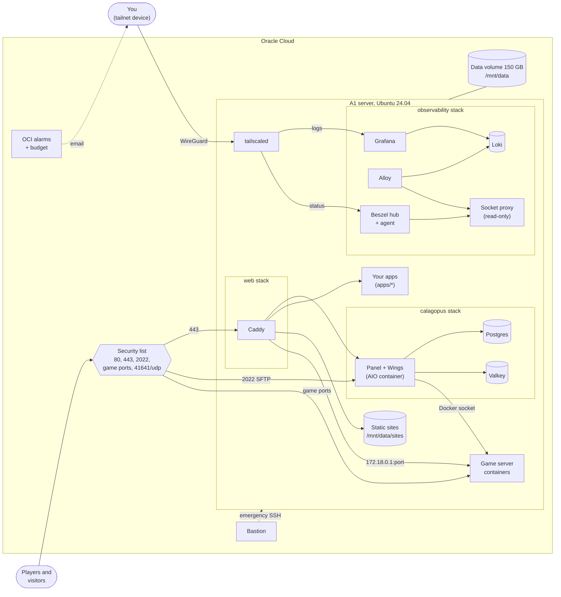
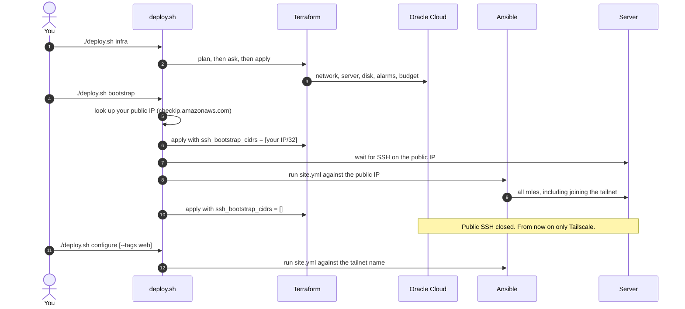
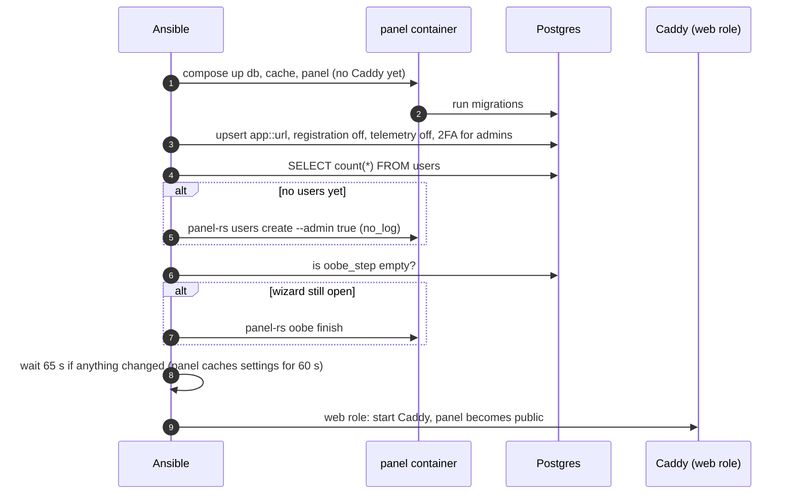
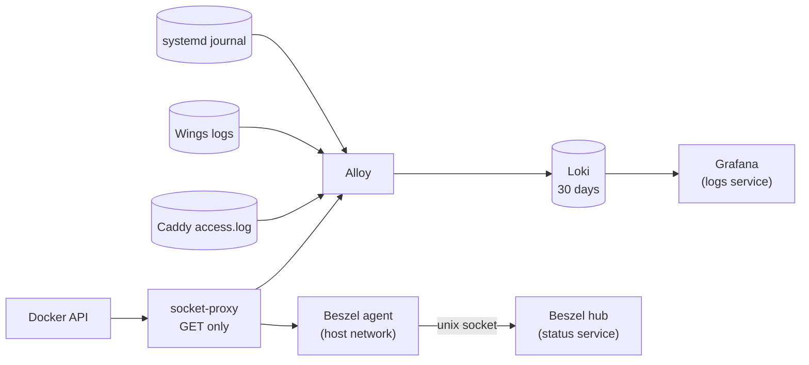
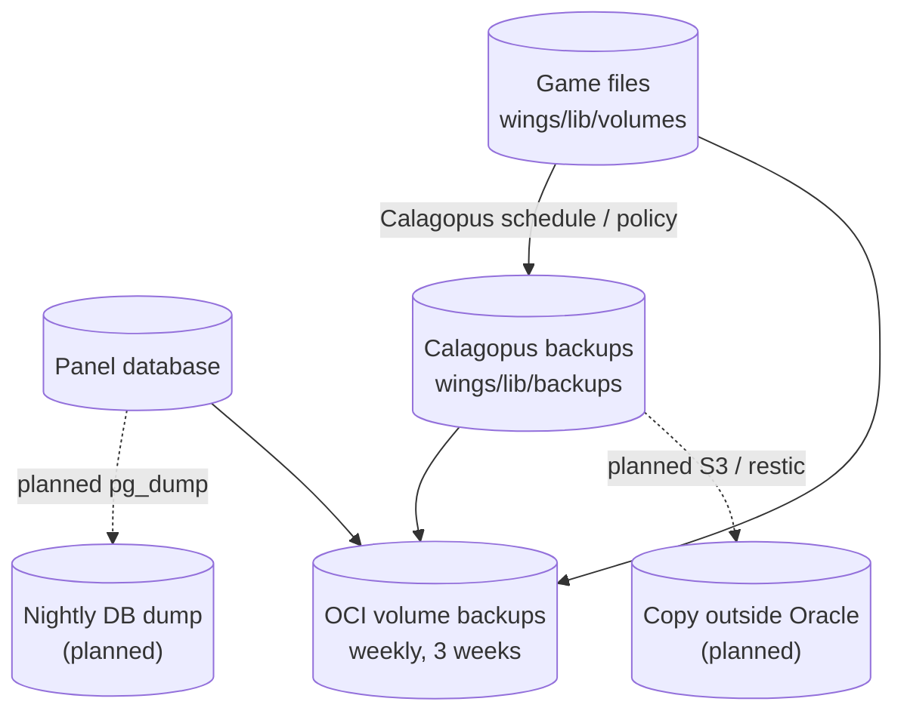

# Design guide

This is the complete explanation of how this repo works. It assumes you know Linux, Docker,
Terraform and Ansible basics. It does not assume you remember any decision made while building
it. Every non-obvious choice is written down here together with the reason for it.

State of things: **2026-10-17**. Code is written and tested locally (see
[How it was tested](#16-how-it-was-tested)), but **nothing has run on the real server yet**. When
the code changes, update this guide in the same commit.

**Contents**

1. [What this is](#1-what-this-is)
2. [The constraints that shaped everything](#2-the-constraints-that-shaped-everything)
3. [The big picture](#3-the-big-picture)
4. [Repository tour](#4-repository-tour)
5. [Where settings come from](#5-where-settings-come-from)
6. [The deploy flow (`deploy.sh`)](#6-the-deploy-flow-deploysh)
7. [Oracle Cloud layer (Terraform)](#7-oracle-cloud-layer-terraform)
8. [Host layer (Ansible roles 1–5)](#8-host-layer-ansible-roles-15)
9. [Calagopus: the game panel](#9-calagopus-the-game-panel)
10. [Web: Caddy, websites and apps](#10-web-caddy-websites-and-apps)
11. [Monitoring](#11-monitoring)
12. [Networking reference](#12-networking-reference)
13. [Security model](#13-security-model)
14. [Data, storage and backups](#14-data-storage-and-backups)
15. [Running it: tasks step by step](#15-running-it-tasks-step-by-step)
16. [How it was tested](#16-how-it-was-tested)
17. [Quirks and gotchas, all in one place](#17-quirks-and-gotchas-all-in-one-place)
18. [Known gaps](#18-known-gaps)
19. [Glossary](#19-glossary)

---

## 1. What this is

One Oracle Cloud server that hosts:

- **Game servers for friends** (Minecraft, Factorio, …), managed through
  [Calagopus](https://calagopus.com), a web panel. Calagopus is a Rust rewrite in the
  Pterodactyl/Pelican family. Its two parts are the **panel** (web UI + API) and **Wings** (the
  agent that runs each game server as a Docker container).
- **A static website** (an Astro blog at the root domain) and **one or two small web apps**.
- **Monitoring** that tells you about health problems and suspicious traffic.

Everything is described as code. **Terraform** creates the cloud resources. **Ansible**
configures the server. **`deploy.sh`** ties them together.

## 2. The constraints that shaped everything

Most odd-looking decisions trace back to one of these.

| Constraint | Consequence |
| :--- | :--- |
| **Must stay free** on a Pay As You Go account (anything above the free amounts is billed, not blocked) | Exactly one A1 server at 4 OCPU / 24 GB. 50 GB system disk + 150 GB data disk = the full 200 GB free storage. At most 5 volume backups. Alarms sized to stay under 1,000 emails a month. Terraform validations refuse bigger shapes. |
| **Security is a top priority** | No admin interface on the internet. Admin access goes over Tailscale. The panel can't be claimed before the first admin exists. Secrets stay out of container environments. Images are pinned. |
| **Monitoring and security events matter** | A real log pipeline (Loki + Alloy + Grafana) instead of just `docker logs`, plus Beszel for health and OCI alarms from outside. |
| **One machine, ARM (Ampere)** | No high availability. Some games have no ARM build (see [Known gaps](#18-known-gaps)). Every image must exist for `arm64`. |
| **Maintainable without help later** | Plain compose files, one list for websites, re-runnable commands, this guide. |
| **The repo is public on GitHub** | Domain, IP, passwords and Terraform state are gitignored. Nothing secret appears in tracked files. |

## 3. The big picture



Read it as three layers:

1. **Oracle Cloud** (Terraform, `oci/`): the network, its firewall (the *security list*), the
   server, the data disk, backups, alarms and the budget.
2. **The host** (Ansible roles `base`, `storage`, `docker`, `firewall`, `tailscale`): OS
   hardening, the data disk mount, Docker, small firewall additions, and private admin access.
3. **Three Docker Compose stacks plus your apps** (Ansible roles `calagopus`, `web`,
   `observability`):
   - `calagopus`: the game panel and its database and cache.
   - `web`: Caddy, the only process on ports 80/443.
   - `observability`: monitoring.
   - Your apps are extra compose projects in `apps/`.

Game server containers are not part of any compose stack. Wings creates and destroys them
through the Docker socket, on its own Docker network.

## 4. Repository tour

| Path | What it is |
| :--- | :--- |
| `README.md` | Short user guide: setup, everyday tasks, troubleshooting table. |
| `docs/GUIDE.md` | This document. |
| `PLAN.md` | Status table, roadmap checkboxes, decisions log (D1–D11), test results. |
| `deploy.sh` | `infra` / `bootstrap` / `configure`. See [section 6](#6-the-deploy-flow-deploysh). |
| `scripts/init-vault.sh` | Creates or completes the encrypted Ansible vault without printing secrets. |
| `scripts/publish-site.sh` | Uploads a built static site over Tailscale with `rsync --delete`. |
| `flake.nix` | `nix develop` shell: terraform, ansible, ansible-lint, openssh, jq, shellcheck, oci-cli. Terraform is unfree, so it isn't in the binary cache and nix compiles it. `nix develop --profile .direnv/flake-profile` makes the shell a GC root, so automatic garbage collection doesn't delete the build (`.direnv/` is gitignored). |
| `oci/*.tf` | Terraform. `api_key.pem`, `terraform.tfvars` and `terraform.tfstate` live here and are gitignored. |
| `ansible/ansible.cfg` | Inventory path, vault password file, SSH options. |
| `ansible/site.yml` | The playbook: a vault sanity check, then 8 roles in a fixed order. |
| `ansible/requirements.yml` | Collections: community.docker, community.general, ansible.posix. |
| `ansible/group_vars/all/vars.yml` | **Your** settings (domain, emails, sites, apps). Gitignored. A copy of `vars.yml.example`. |
| `ansible/group_vars/all/vault.yml` | **Your** secrets, encrypted with ansible-vault. Gitignored. |
| `ansible/group_vars/all/images.yml` | Every container image, pinned by tag + digest. Tracked. |
| `ansible/group_vars/all/network.yml` | Internal Docker addressing for the shared `web` network. Tracked. |
| `ansible/roles/<role>/` | `tasks/`, `defaults/` (every tunable), `templates/`, sometimes `files/` and `handlers/`. |
| `apps/<name>/compose.yml` | Your web apps. `apps/example/` is a commented template. |
| `.gitignore` | Keeps state, secrets, inventory, `.ansible/` and `oci/tfplan` out of git. |

## 5. Where settings come from

### The four places you edit

| File | Holds | Tracked in git? |
| :--- | :--- | :--- |
| `oci/terraform.tfvars` | Oracle account IDs, region, `notification_email`. Optionally `game_port_range`, `instance_ocpus`, etc. | No |
| `ansible/group_vars/all/vars.yml` | Domain, emails, timezone, Tailscale hostname, `sites:`, `apps:`. Any role default can be overridden here. | No |
| `ansible/group_vars/all/vault.yml` | Passwords and keys (see [secrets inventory](#secrets-inventory)). | No (encrypted anyway) |
| `apps/<name>/` | Your app's compose file and config. | Yes, so no secrets in here |

### Ansible variable precedence in this repo

From lowest to highest priority: **role defaults** (`roles/*/defaults/main.yml`), then
**group_vars/all/** (vars.yml, vault.yml, images.yml, network.yml), then **facts set during the
run**, then **`-e` extra vars**. In practice:

- To change a role's behaviour, put the same variable name in `vars.yml`.
- `sites` and `apps` deliberately aren't defined in any role default. The web role uses
  `sites | default([])`, so they only ever come from `vars.yml`.

### The full list of variables you'll care about

| Variable | Default | Effect |
| :--- | :--- | :--- |
| `domain_name` | — | Used to build hostnames. |
| `panel_hostname` | `panel.{{ domain_name }}` | The panel's public hostname. Also written into the panel's `app::url` setting. |
| `acme_email` | — | Let's Encrypt account email. |
| `acme_staging` | `false` | Use Let's Encrypt staging (untrusted certificates, generous rate limits) while testing DNS. |
| `timezone` | `Europe/Warsaw` | Host timezone. Also sets the time of the 05:30 reboot window. Passed as `TZ` to containers. |
| `data_block_device` | `/dev/oracleoci/oraclevdb` | Consistent device path of the data volume. |
| `data_fs_label` | `gamedata` | XFS label. The disk is mounted by label. |
| `data_mount_point` | `/mnt/data` | Where all persistent data lives. |
| `tailscale_hostname` | `calagopus` | The server's tailnet name. `deploy.sh configure` connects to it. |
| `tailscale_tags` | `["tag:gameserver"]` | Tags applied when joining. They must exist in your tailnet policy. |
| `calagopus_admin_username` / `_email` | `admin` / — | The first panel admin, created by Ansible. |
| `sites` | example list | Websites (see [section 10](#10-web-caddy-websites-and-apps)). |
| `apps` | `[]` | Folder names in `apps/` to deploy. |
| `calagopus_settings` | 4 keys | Panel settings forced on every run (role default; override the whole dict to change). |
| `calagopus_wings_disk_limiter_mode` | `xfs_quota` | Per-game-server disk limits. Set `none` if quotas don't work on the host. |
| `observability_loki_retention` | `720h` | How long logs are kept. |
| `base_unattended_reboot_time` | `05:30` | Automatic reboot time after updates that need one. |

## 6. The deploy flow (`deploy.sh`)

There are three modes, used in this order the first time. After that you mostly use `configure`.



What each mode does exactly:

- **`infra`**: `terraform init`, then `plan -out=tfplan`. It asks y/N, then runs
  `apply tfplan`. It never uses `-auto-approve`.
- **`bootstrap`**:
  1. `preflight` checks that `vars.yml`, `vault.yml` and `.vault_pass` (mode 600) exist, and the SSH key.
  2. Opens SSH to your current IP through a Terraform apply, which shows a plan and asks.
  3. Waits up to 150 s for SSH.
  4. Writes `ansible/inventory.ini` with the **public IP**, then runs the whole playbook.
  5. Closes SSH again with a second apply.
  If anything fails in between, an `EXIT` trap prints a warning that SSH is still open to your
  IP. Run `./deploy.sh infra` to close it.
- **`configure`**: writes `inventory.ini` with the **tailnet name** (from `tailscale_hostname`
  in `vars.yml`, or `$TS_HOST`) and runs the playbook. Extra arguments go to
  `ansible-playbook`, for example `--tags web`, `--check --diff` or `--start-at-task`.
  **It doesn't touch Terraform**, so it needs no Oracle credentials.

Quirks:

- **The API key passphrase is asked for once per run.** `private_key_pass` is an *ephemeral*
  Terraform variable: never stored in state or plan files. Applying a saved plan
  (`apply tfplan`) therefore needs it again, and Terraform errors instead of prompting.
  `deploy.sh` asks once (`ask_key_passphrase`) and exports `TF_VAR_private_key_pass` for every
  call in that run. To skip the prompt entirely, export it yourself first:
  ```bash
  read -rs TF_VAR_private_key_pass && export TF_VAR_private_key_pass
  ```
- **Host keys are trusted on first use.** Ansible's SSH uses `StrictHostKeyChecking=accept-new`:
  the first connection to a name or IP stores its key, and later mismatches fail. The public IP
  and the tailnet name are separate entries in `~/.ssh/known_hosts`. If you ever rebuild the
  server, remove the old entries with `ssh-keygen -R <ip-or-name>`.
- **`inventory.ini` is generated.** It's gitignored and overwritten on every run, and it always
  contains exactly one host, named `calagopus`.
- **The SSH key must match.** `SSH_KEY` (default `~/.ssh/id_ed25519`) is the private half of
  `ssh_public_key_path` in Terraform (default `~/.ssh/id_ed25519.pub`).

## 7. Oracle Cloud layer (Terraform)

All files are in `oci/`. State is local (`oci/terraform.tfstate`, gitignored). It's the only
copy: back it up, or Terraform loses track of what it created.

### `provider.tf`

The OCI provider with an API signing key (`api_key.pem`, password-protected) and the ephemeral
passphrase variable. That needs Terraform ≥ 1.10, which the nix shell provides.

### `network.tf`

- **VCN** `10.0.0.0/16` and **subnet** `10.0.1.0/24` (computed with `cidrsubnet(vcn, 8, 1)`).
  There's an internet gateway and a default route. IPv6 isn't set up.
- **Security list** (Oracle's firewall in front of the server). This is the **real perimeter**,
  because Docker-published ports bypass the host's own firewall (see
  [section 12](#12-networking-reference)).

  | Port | Protocol | From | For |
  | :--- | :--- | :--- | :--- |
  | 80 | TCP | anywhere | Let's Encrypt HTTP challenge, redirect to HTTPS |
  | 443 | TCP | anywhere | Panel, websites, apps |
  | 2022 | TCP | anywhere | Wings SFTP |
  | `game_port_range` (default 25500–25600) | TCP + UDP | anywhere | Game servers |
  | 22 | TCP | the VCN only (`10.0.0.0/16`) | OCI Bastion (emergency SSH) |
  | 22 | TCP | `ssh_bootstrap_cidrs` (normally empty) | First bootstrap only |
  | 41641 | UDP | anywhere | Direct Tailscale connections |
  | ICMP 3/4 | — | anywhere | Path-MTU discovery (needed or some connections hang) |
  | ICMP 3 | — | the VCN | Unreachable messages inside the VCN |

  Egress is fully open.

### `compute.tf`

- **Shape** `VM.Standard.A1.Flex`, with `instance_ocpus` / `instance_memory_gbs` (defaults 4 /
  24). Validations reject anything above 4 / 24 so you can't create a billed shape by accident.
  Oracle's docs list 2 / 12 for Always Free–only accounts since June 2026. Pay As You Go
  accounts keep 4 / 24, per Oracle support.
- **Placement:** availability domain `[0]` of your region. A1 capacity is sometimes exhausted;
  if creation fails with "out of host capacity", that's why.
- **Image:** the newest Ubuntu 24.04 image compatible with A1, **at creation time**.
- **`lifecycle.ignore_changes = [source_details[0].source_id, metadata]`.**
  - The image data source always returns the newest build. Without this, every new Canonical
    image would make Terraform want to **destroy and recreate the server**.
  - `preserve_boot_volume = true` would then leave the old 50 GB system disk behind. That
    pushes storage over the free 200 GB.
  - `metadata` (the SSH key) is ignored because Oracle only uses it on first boot.
  - Updates to the OS come from apt, not from new images.
- **Agent plugins:** "Compute Instance Monitoring" (feeds the alarms) and "Bastion" (emergency SSH).
- **Display name:** `instance_name`, default `calagopus`.

### `storage.tf`

- **150 GB block volume.**
- **Paravirtualized attachment** with a **consistent device path**: `/dev/oracleoci/oraclevdb`.
  Ansible uses that path, never a guessed `/dev/sdX`.
  - **Quirk:** setting `device` on an existing attachment forces Terraform to *replace* the
    attachment (detach + attach). On the current server that's harmless, because the disk was
    never formatted.
  - **Never change this attachment again once the disk holds data and is mounted.** Terraform
    would detach a live disk.
- **Weekly backup policy:** incremental, Mondays 04:00 UTC, each backup kept 21 days. So at
  most 3 exist, plus 1 while a new one is created.
  - The free allowance is **5 volume backups in total, system and data disks combined**.
  - Manual backups count against those 5. At the limit, new backups fail (or, on PAYG, may be
    billed).
  - Turn the policy off with `enable_volume_backups = false`.

### `monitoring.tf`

- A Notifications **topic** with an **email subscription** to `notification_email`.
  **Oracle sends a confirmation email after the first apply. Nothing is delivered until you
  click it.**
- **Two alarms** on the `oci_computeagent` metrics of this instance:
  - **`instance-down` (critical):** `CpuUtilization[1m]{…}.absent()` for 5 minutes. It fires
    when *no metrics arrive at all*: the server is off, its network is down, or the agent died.
    Oracle evaluates it, so it works when the server can't.
  - **`memory-high` (warning):** mean memory above 90 % for 15 minutes.
- **Repeat:** both re-notify every 4 hours while firing. Worst case: 2 alarms × 6 a day × 30
  days ≈ 360 emails a month, under the free 1,000.
- **No CPU alarm on purpose:** game servers legitimately use 100 % CPU for long periods.
- **Disk fill isn't available** from the OCI agent. Beszel covers it from inside.

### `budget.tf`

A **$1 monthly budget** on the root compartment. It has two alert rules: *forecast* reaching
100 % ($1), and *actual* spend reaching 50 % ($0.50). This is your tripwire: the first real
charge emails you.

### `outputs.tf`

- `public_ip`: for DNS records. It's an **ephemeral** IP: it stays as long as the instance
  exists, but a recreated instance gets a new one.
- `instance_id`
- `private_ip`: the target for Bastion sessions.
- `data_device`

## 8. Host layer (Ansible roles 1–5)

`site.yml` runs as root (`become: true`) against the single host. Before any role, a
`pre_tasks` assert checks that the vault has every secret, with minimum lengths.

**Role order is part of the design:**

1. `base`
2. `storage`
3. `docker`
4. `firewall`
5. `tailscale`
6. `calagopus`
7. `web`
8. `observability`

The only order that's truly critical is **`web` after `calagopus`** (see
[the exposure gate](#the-exposure-gate)). The rest follows dependencies: Docker needs the disk
mounted, the firewall changes Docker's chain, and so on.

Every role can run alone with `--tags <role>`. Roles that need runtime facts (the data disk's
device, the tailnet name) look them up themselves.

### Role `base`

- **Packages:** curl, jq, xfsprogs, python3-yaml (for the Compose modules), rsync (for
  `publish-site.sh`), unattended-upgrades, needrestart.
- **Timezone** from `timezone`.
- **SSH hardening** with a drop-in, `/etc/ssh/sshd_config.d/10-hardening.conf`:
  - No root login, keys only, `AllowUsers ubuntu`.
  - No X11 or agent forwarding.
  - Local TCP forwarding *allowed* (handy for `ssh -L`).
  - 3 auth tries.
  - **Safety net:** after writing the drop-in, `sshd -t` validates the whole config. If that
    fails, a `rescue` block deletes the drop-in and stops the play, so a broken file never
    survives to lock you out at the next sshd restart. sshd is only *reloaded*, never restarted.
- **Unattended upgrades** (`52unattended-upgrades-local`):
  - Ubuntu security updates (enabled by Ubuntu itself), **plus the Docker and Tailscale apt repos**.
  - Automatic reboot at **05:30 local time** when an update needs one.
  - Old kernels and unused dependencies are removed.
  - A Docker upgrade restarts `dockerd`, but `live-restore` keeps containers running.
  - A reboot restarts everything, which briefly takes game servers down.
- **`br_netfilter`** is loaded now and at boot. Wings' per-server firewalls need bridged traffic
  to pass through iptables (`net.bridge.bridge-nf-call-iptables=1`).
- **sysctls** (`/etc/sysctl.d/60-gameserver.conf`):
  - Loose reverse-path filtering (`rp_filter=2`), which Docker and Tailscale need.
  - ICMP redirects and source routing off.
  - `dmesg_restrict`, `kptr_restrict=2`.

### Role `storage`

1. **Wait** up to 60 s for `/dev/oracleoci/oraclevdb`, and **fail hard** if it isn't there.
   Otherwise data would silently land on the 50 GB system disk.
2. **Inspect it with `blkid`**:
   - Exit code 2 means the disk is empty, so it's formatted as XFS with label `gamedata`.
   - XFS with the right label means it's ours, so it's left alone.
   - **Anything else stops the play.** This role never reformats.
3. **Mount by label** at `/mnt/data` with `defaults,prjquota,nofail`, written to `/etc/fstab`.
   - **`prjquota`** turns on XFS project quotas, which Wings uses for per-server disk limits.
     **XFS only accepts it at mount time.** If the disk was ever mounted without it, a remount
     won't help: you must `umount` then `mount`. The play checks for this and tells you.
   - **`nofail`** keeps the server bootable if the disk is late or missing.
4. **A systemd drop-in for `docker.service`**, `RequiresMountsFor=/mnt/data`. Docker refuses to
   start without the data disk, so containers can never write into an empty `/mnt/data` folder
   on the system disk. This works together with `nofail`.

### Role `docker`

- Docker CE from Docker's apt repo (arm64), plus the compose plugin. `state: present`:
  upgrades come from unattended-upgrades, not from re-running the playbook.
- **`/etc/docker/daemon.json`:**
  - `log-driver: local` with `max-size 20m`, `max-file 5`. Compressed, bounded container logs,
    so they can't fill the disk. Long-term logs live in Loki.
  - `default-address-pools: 10.211.0.0/16` in /24 chunks. Any network Docker creates without an
    explicit subnet lands here: away from Wings' `172.18.0.0/16`, the VCN `10.0.0.0/16`, and our
    own `10.210.x` networks.
  - `live-restore: true`: containers keep running while `dockerd` restarts or upgrades.
  - Changing `daemon.json` restarts Docker (with live-restore, containers survive). Address-pool
    changes only affect newly created networks.
- **The shared `web` network:**
  ```bash
  docker network inspect web || docker network create --subnet 10.210.1.0/24 --ip-range 10.210.1.128/25 web
  ```
  - **Quirk, learned the hard way in testing:** Caddy has a fixed address (`10.210.1.2`). The
    panel joins `web` before Caddy starts. Without `--ip-range`, Docker gave the panel `.2`,
    and Caddy then failed with "Address already in use".
  - With `--ip-range`, automatic addresses come only from `.128–.255`.
  - The network's **gateway becomes `.128`**: Docker uses the first address of the ip-range.
  - The command only *creates*. If the network exists with other settings, it isn't changed.
    Changing it means stopping everything attached, `docker network rm web`, and re-running.

### Role `firewall`

**What Oracle's Ubuntu image ships with** (`/etc/iptables/rules.v4`, loaded at boot by
`netfilter-persistent`):

- **INPUT:** allows established connections, ICMP, loopback and SSH. **Rejects everything else.**
- **FORWARD:** rejects everything. Docker inserts its own rules ahead of this, so containers work.
- **OUTPUT:** a chain `InstanceServices` that lets only *root* reach Oracle's metadata and
  iSCSI services on `169.254.0.0/16`.

**What this role does:**

- **Removes UFW.** UFW and `iptables-persistent` fight each other, and UFW wouldn't protect
  Docker-published ports anyway.
- **Accepts all traffic arriving on `tailscale0`**, and UDP 41641 (direct Tailscale connections).
- **Blocks containers from the metadata service.** The `DOCKER-USER` chain rejects traffic from
  containers to `169.254.0.0/16`, except DNS to `169.254.169.254:53` (Oracle's resolver, which
  Docker's DNS forwards to).
  - **Why:** game servers run code you don't control (mods, plugins). The metadata service
    shows instance details, and on other setups it would hand out cloud credentials.
  - **Docker reuses `DOCKER-USER`** if it exists. It only creates the chain and the jump to it.
- **Every rule is applied twice:**
  1. **Live**, with the `iptables` module. It's idempotent: it checks before inserting, and
     inserts at position 1.
  2. **In `rules.v4`**, for reboots, with `lineinfile`/`blockinfile`: before the
     `-A INPUT -j REJECT` line, after `:InstanceServices`, and before `COMMIT`.
- **Never run `netfilter-persistent save` or `reload`.** `save` would write Docker's dynamic
  chains into `rules.v4`. `reload` (iptables-restore) would wipe Docker's live chains and cut
  off every container until Docker restarts.
- Only IPv4 is handled. The VCN has no IPv6.

**At boot**, `netfilter-persistent` loads `rules.v4` (our rules included) before Docker starts.
Docker then adds its chains in front.

### Role `tailscale`

- **Installs** Tailscale from its apt repo.
- **Joins the tailnet** if the node isn't already logged in. A one-off auth key from the vault
  is written to `/run/tailscale-authkey` and passed as `--auth-key=file:…`, so it never shows in
  the process list. The file is deleted in an `always:` block, even on failure.
  - Flags: `--hostname`, `--advertise-tags`, `--ssh=false` (normal OpenSSH stays in charge).
- **Tagged devices have key expiry turned off** by default. Untagged ones would drop off after
  180 days.
- **Checks HTTPS certificates first.** If the tailnet doesn't have MagicDNS + HTTPS
  certificates enabled, `tailscale serve` starts an *interactive* consent flow and the play
  would hang forever. So the role first checks `CertDomains` in `tailscale status --json` and
  fails with instructions if it's empty.
- **Publishes the dashboards as Tailscale Services**, one private name per dashboard and no port:

  | Tailnet address | Service | Goes to |
  | :--- | :--- | :--- |
  | `https://logs.<tailnet>.ts.net` | `svc:logs` | Grafana (`127.0.0.1:3000`) |
  | `https://status.<tailnet>.ts.net` | `svc:status` | Beszel (`127.0.0.1:8090`) |

  - The command is `tailscale serve --service=svc:<name> --https=443 <target>`. The names are
    `grafana_service_name` / `beszel_service_name` in `group_vars/all/network.yml`.
  - **Requirements:**
    - Services need a **tagged** host and Tailscale ≥ 1.86. The server has both.
    - Each name must be **defined in the console** first (Services → Advertise → Define a
      Service, endpoint `tcp:443`).
    - The host must be **approved** as that service's proxy: either automatically via
      `autoApprovers.services` in your policy, or by hand on the Services page.
    - Users need a **grant** to `svc:<name>` on port 443.
  - **If a service isn't defined yet**, the publish task fails with a message that says so,
    instead of a raw error.
  - **Old per-port entries are cleaned up.** The `:8443`/`:8444` entries from before Services
    are removed automatically when present (`tailscale_legacy_serve_ports`).
  - Serve config survives reboots. The command is idempotent and runs every time. `timeout 30`
    guards against hangs.
  - **Removing a service:** taking it out of `tailscale_services` does *not* unpublish it. On
    the server, run `tailscale serve drain svc:<name>`, then `tailscale serve clear svc:<name>`.
- **Certificates are public.** Tailscale's certificates are logged publicly, so your tailnet
  name and server name are visible in certificate-transparency logs. The services themselves
  stay private.

## 9. Calagopus: the game panel

### What runs

Compose project `calagopus` in `/opt/stacks/calagopus`:

| Service | Image | Networks | Notes |
| :--- | :--- | :--- | :--- |
| `panel` | `ghcr.io/calagopus/panel:<ver>-aio` | `web`, `backend` | Panel + Wings in one container ("AIO", all-in-one). Publishes only 2022 (SFTP). |
| `db` | `ghcr.io/calagopus/pgautoupgrade:18.6-alpine` | `backend` | Postgres 18. Upgrades its data files automatically on a major version bump. |
| `cache` | `ghcr.io/calagopus/valkey:9.1.2` | `backend` | Valkey (Redis fork): cache, rate limits, sessions. |

`backend` is `internal: true`, so Postgres and Valkey have **no route to the internet**. Only
the panel can reach them.

### Why the all-in-one image

For one node, Calagopus recommends the AIO image. The panel starts a bundled Wings as a child
process. Browsers reach Wings through the panel at `/wings-proxy/<node>/` (consoles, uploads,
downloads), so Wings' own API port (8080 in a normal setup) is never published. Wings listens
on `127.0.0.1:64332` inside the container.

**The cost:** Wings needs the Docker socket, so **the panel container controls Docker, which
means it's effectively root on the host**. A panel admin account is therefore as powerful as
SSH. This is the main reason admin two-factor login is enforced, and why friends should never
be panel admins.

### Quirk: the panel's config comes from `/.env`, not the environment

`panel.env` is mounted read-only at **`/.env`**. The panel loads `.env` from its working
directory, and the image's working directory is `/`.

- **Why:** values passed with `environment:` or `env_file:` appear in `docker inspect`, and
  therefore to anything that can read the Docker API (including the monitoring tools through
  the socket proxy). A mounted file doesn't.
- **Verified locally:** no secret shows up in `docker inspect` for any container in the stack.

`panel.env` contents (from `templates/panel.env.j2`):

| Setting | Value | Why |
| :--- | :--- | :--- |
| `DATABASE_URL` | `postgresql://panel:<pw>@db:5432/panel` | |
| `REDIS_URL` | `redis://:<pw>@cache:6379` | |
| `DATABASE_MIGRATE` | `true` | Migrations run on every start. |
| `APP_ENABLE_WINGS_PROXY` | `true` | The AIO serves Wings through the panel. |
| `APP_ENCRYPTION_KEY` | 64 hex chars | Encrypts secrets in the DB: node tokens, OAuth secrets, backup credentials, TOTP seeds. **Never change it casually** (see [rotation](#secrets-inventory)). |
| `APP_USE_DECRYPTION_CACHE` | `false` | Otherwise decrypted secrets linger 30 s in memory. |
| `APP_TRUSTED_PROXIES` | `10.210.1.2` (Caddy only) | The panel believes `X-Forwarded-For` only from Caddy. Apps on the same `web` network can't fake visitor IPs. Verified locally. |
| `AIO_BASE_WINGS_CONFIGURATION` | `/wings-config.yml` | See the next quirk. |

### Quirk: the Wings config is copied in at every start

The AIO **reads and rewrites** the file named by `AIO_BASE_WINGS_CONFIGURATION` on every start.
It merges in a fresh node token, the node UUID, `remote: http://localhost:8000`, the Wings API
host and port, and a 10 GB upload limit.

If Ansible's file were mounted directly:

- read-only, the AIO couldn't write it;
- read-write, every Ansible run would undo the AIO's changes, and the AIO would undo Ansible's.

So the compose file **overrides the entrypoint**:

```yaml
entrypoint: [/bin/sh, -c, 'cp /etc/calagopus-aio/wings-base.yml /wings-config.yml && exec /usr/bin/panel-rs "$$@"', panel-rs]
```

- Ansible owns `wings-base.yml`, mounted read-only.
- Each container start gets a fresh scratch copy in the container's own filesystem.
- The `$$` is Compose's escape for a literal `$`.
- **If a future image changes its entrypoint or binary path, this line is the first thing to
  check.**

`wings-base.yml` sets:

- `root_directory` / `log_directory` on the data disk (`/mnt/data/wings/lib`, `/mnt/data/wings/log`)
- `disk_limiter_mode: xfs_quota`
- `websocket.max_connections_total: 512`. Upstream ships unlimited, which lets one client
  exhaust connections.

### Quirk: Wings paths must be the same inside and outside the container

Wings asks the **host's** Docker daemon to bind-mount server folders into game containers. The
daemon resolves those paths on the host, so these are mounted at **identical paths**:

- `/mnt/data/wings/lib:/mnt/data/wings/lib`, holding everything under it:
  - `volumes/`: the game files
  - `backups/`: local Calagopus backups
  - `diffs/`, `vmounts/`, `archives/`, `tmp/`
- `/mnt/data/wings/log`
- `/etc/calagopus-wings` (on the system disk; the AIO regenerates its contents)
- `/var/lib/docker/containers` (Wings reads game console logs from there)

### Quirk: disk quotas need `SYS_ADMIN` and the block device

Wings applies per-server disk limits with XFS project quotas (`xfs_quota`, which the AIO image
includes). Setting limits calls `quotactl()`, which needs `CAP_SYS_ADMIN` **and access to the
block device**. So, when `calagopus_wings_disk_limiter_mode` is `xfs_quota`:

- The role looks up the real device behind `/mnt/data` with `findmnt` (for example `/dev/sdb`).
- That device is passed into the container under the same name, plus `cap_add: [SYS_ADMIN]`.

This adds no real privilege: the container already holds the Docker socket.

`/etc/projects` (the XFS project list) lives inside the container and is lost on recreation.
Wings re-registers every server's project at startup, and the quota data itself lives on the
disk.

### Postgres and Valkey details

- **Postgres** reads its password from `POSTGRES_PASSWORD_FILE` (a Compose `secret`).
  - **It only uses the password when it first creates the database.** Changing the vault value
    later breaks the panel's login to the DB, unless you first run `ALTER ROLE panel PASSWORD '…'`.
  - Local connections inside the container are trusted, which is how Ansible runs `psql`
    without a password.
  - Its data folder `/mnt/data/postgres` is owned by **uid/gid 70**, the `postgres` user in
    the Alpine image. Ansible creates it with that owner on purpose. The first version created it
    as root: Postgres took it over on first start, and the next Ansible run handed it back to
    root, which broke the database ("could not open file global/pg_filenode.map: Permission
    denied"). That happened on the real server and was fixed with `chown 70:70`.
- **Valkey** reads `valkey.conf` (password with `requirepass`, RDB snapshot every 60 s if
  anything changed, no AOF).
  - Runs as uid `999` with all capabilities dropped. Its data folder must be owned by uid 999.
    Ansible does that.
  - If it isn't, Valkey can't snapshot, refuses writes ("MISCONF"), and *every* logged-in panel
    request returns 500. Seen in testing.
  - **Healthcheck:** `valkey-cli ping` without a password returns `NOAUTH`, which still proves
    the server is up. This keeps the password out of the healthcheck command, which
    `docker inspect` would show.
- **Secret files.** `/opt/stacks/calagopus/secrets/` is mode 0700 (root only). The files in it
  are 0644, so the container users (postgres, uid 999) can read their bind mount. `panel.env`
  is 0600 root (the panel runs as root). `valkey.conf` is 0644 inside the 0750 stack folder.

### Config-hash labels: how config changes reach containers

Config files are bind-mounted **as single files**. Ansible writes files with an atomic rename,
which creates a new inode. A running container keeps the old inode, so it never sees the change.

The fix is a label on each service:

```yaml
labels:
  config-hash: "{{ lookup('template', 'panel.env.j2') ... | hash('sha256') | truncate(16) }}"
```

- The hash is computed on your machine while rendering `compose.yml`.
- When a config file's content changes, the label changes. Compose sees a changed service
  definition and **recreates exactly that container**.
- Covered: panel (`panel.env` + `wings-base.yml`), cache (`valkey.conf`), and in other stacks
  Caddy, Loki, Alloy, Grafana and Beszel.
- **Not** covered: `db`. Postgres ignores password changes anyway (see above).
- The 16-character prefix of a SHA-256 over high-entropy secrets reveals nothing useful.

### The exposure gate

**The problem:** a fresh Calagopus shows a setup wizard ("OOBE"), and the **first account
created there becomes admin**. On a public IP, whoever opens the site first owns the panel, and
with it the server.

**The fix:** `roles/calagopus/tasks/bootstrap.yml` runs while **no Caddy exists yet**. Nothing
public can reach the panel, because port 8000 is never published.



Details that matter:

- **Settings write** is one SQL statement:
  `INSERT … ON CONFLICT (key) DO UPDATE … WHERE settings.value IS DISTINCT FROM EXCLUDED.value`.
  psql prints `INSERT 0 <rows written>`. `INSERT 0 0` means nothing changed, and that's how
  Ansible reports changed / ok.
- **The enforced settings** (`calagopus_settings`). Upstream defaults are in brackets:
  - `app::url = https://panel.<domain>`. Needed for the `Secure` cookie flag and `wss://`
    console links.
  - `app::registration_enabled = false` [true]
  - `app::telemetry_enabled = false` [true; a daily report goes to calagopus.com]
  - `app::two_factor_requirement = admins` [none]
- **These are re-applied on every run.** Changing them in the panel UI is undone next run.
  Change them in `calagopus_settings` instead.
- **Admin creation** passes the password as a CLI argument inside the container. That's
  briefly visible in the container's process list. The task uses `no_log` so it isn't in
  Ansible output. The CLI needs every flag when there's no terminal; `tty: false` is set on all
  exec calls for that reason.
- **Two-factor for admins, as tested:** an admin without 2FA can log in and reach their
  account page (to enrol), but every admin API call returns
  `403 "two-factor authentication required"`.
- **Registration off, as tested:** `POST /api/auth/register` returns `"registration is disabled"`.
  Subuser invites from the panel still create accounts (see [friends](#give-a-friend-control-of-one-game-server)).

### Smoke test (`tasks/smoke.yml`)

- The panel answers `curl http://127.0.0.1:8000/` inside its container.
- `xfs_quota -x -c "state -p" /mnt/data/wings/lib` inside the container shows accounting
  **and** enforcement ON. It checks `wings/lib`, not `/mnt/data`, because inside the container
  only the Wings folders are mount points. Asking about `/mnt/data` fails with "cannot setup
  path for mount". **This fails loudly if quotas don't work.** The fallback is
  `calagopus_wings_disk_limiter_mode: none`.
- Port 2022 accepts connections.

## 10. Web: Caddy, websites and apps

### Caddy's place

Compose project `web` (`/opt/stacks/web`). Its only service is Caddy:

- Publishes 80 and 443 on all interfaces.
- Fixed IP `10.210.1.2` on the `web` network.
- **Hardening:** read-only root filesystem with a tmpfs `/tmp`, all capabilities dropped except
  `NET_BIND_SERVICE`, `no-new-privileges`.
- **Persistent data:**
  - `/mnt/data/caddy/data`: the ACME account and certificates. They survive restarts, so
    there's no re-issuing.
  - `/mnt/data/caddy/config`
  - `/mnt/data/caddy/logs`: the access log.
- **Static sites:** `/mnt/data/sites` is mounted read-only at `/srv/sites`.
- **Caddy runs as root but without `CAP_DAC_OVERRIDE`.** So it can write only into folders
  *owned by root*, and read files that are world-readable. Ansible creates its folders as root.
  Blog files owned by `ubuntu` with mode 0644 are readable.

### How the Caddyfile is built

`roles/web/templates/Caddyfile.j2`. Check a change locally before deploying:

```bash
docker run --rm -v $PWD/Caddyfile:/etc/caddy/Caddyfile:ro caddy:<ver> caddy validate --config /etc/caddy/Caddyfile
```

The role also validates on the server before starting Caddy.

1. **Global options:**
   - `email`
   - Optional Let's Encrypt **staging** CA
   - `servers { protocols h1 h2 }`: **no HTTP/3**, because the security list opens only
     443/tcp. Advertising HTTP/3 would make browsers try UDP first and fall back slowly.
2. **`(common)` snippet**, imported by every site:
   - **Access log:** JSON to `/var/log/caddy/access.log`, rolled at 50 MiB, 10 files kept,
     30 days. A filter replaces any `token=` query parameter with `REDACTED` (Calagopus download
     links carry tokens). Caddy already redacts `Cookie` and `Authorization` by default.
   - **Headers:**
     - `Strict-Transport-Security: max-age=31536000`. No `includeSubDomains` and no `preload`,
       on purpose: HSTS is sticky in browsers for a year.
     - `X-Content-Type-Options: nosniff`
     - `Referrer-Policy: same-origin`
     - The `Server` header is removed.
3. **The panel block:**
   - **Request bodies are limited to 128 MiB** (upstream's recommendation), **except
     `/api/remote/backups/*`**, where Wings uploads backups.
   - A panel-specific `Permissions-Policy`.
   - **No compression:** the panel streams consoles over WebSocket and large downloads
     through `/wings-proxy/`.
   - `reverse_proxy panel:8000`, using the Docker DNS name on the `web` network.
4. **One block per entry in `sites:`.** Each site sets exactly one of these (an assert
   enforces it):

   | Type | Caddy config | Notes |
   | :--- | :--- | :--- |
   | `static: <name>` | `root * /srv/sites/<name>`, `encode zstd gzip`, `file_server`, `handle_errors 404 { rewrite * /404.html; file_server }` | Missing page → `/404.html` if it exists. Otherwise a plain 404, with no loop (tested). Small files aren't compressed (Caddy's minimum size). |
   | `proxy: <host:port>` | `reverse_proxy <host:port>` | `<service>:<port>` for apps on the `web` network, or `172.18.0.1:<port>` for a game server's web port. |
   | `redirect: <url>` | `redir <url>{uri} permanent` | 301, keeps the path: `www.x/post/1` → `x/post/1`. |

**Certificates.** Caddy issues one certificate per hostname, using the HTTP-01 challenge on
port 80. So the hostname's DNS must already point at the server.

- Let's Encrypt allows **5 failed validations per hostname per hour**. While DNS isn't ready,
  use `acme_staging: true`.
- Hostnames that aren't in the Caddyfile get **no site**: the TLS handshake fails (tested).
- **Wildcard DNS** (`*.example.com`) is fine. **Wildcard certificates** are not used: they'd
  need the DNS-01 challenge, which means a custom Caddy build with a Porkbun plugin.

### Static sites

- Each `static:` site gets a folder `/mnt/data/sites/<name>`, **owned by `ubuntu`**.
- `scripts/publish-site.sh <name> <folder>` runs, over Tailscale:
  ```bash
  rsync -az --delete <folder>/ ubuntu@<tailscale_hostname>:/mnt/data/sites/<name>/
  ```
  No sudo is needed.
- **`--delete` mirrors the folder.** Files you removed locally disappear on the server too.
  That's the point, but publishing the wrong folder empties the site.
- The script refuses to run if `<folder>/index.html` is missing (to catch publishing before a
  build), and checks that the site name is lowercase.
- Caddy serves the new files immediately. There's no restart or cache.

### Apps

- Each name in `apps:` is a folder `apps/<name>/` with a plain `compose.yml`, not a template.
  `roles/web/tasks/apps.yml` does three things:
  1. **Copies** `apps/<name>/` to `/opt/stacks/apps/<name>/`. Files become mode 0644, so
     scripts lose their executable bit. If an app needs an executable, set it inside the image
     or in the compose `command`.
  2. **Writes `secrets.env`** (mode 0600) if the vault has `vault_app_env.<name>`, one
     `KEY=value` per line. The app loads it with `env_file: [secrets.env]`. Unlike the panel,
     these values *do* show in `docker inspect`. That's the usual Compose trade-off, and fine
     for test apps.
  3. **Runs `docker compose up`**. It recreates the app if any of its copied files changed,
     because single-file mounts would otherwise go stale.
- **Apps start before Caddy**, so their sites work as soon as Caddy is up.
- **The rules for an app's compose file** (written out in `apps/example/compose.yml`):
  - Join the external `web` network.
  - Publish **no** ports.
  - Pin the image by tag + digest.
  - Keep data under `/mnt/data/apps/<name>/`.
  - Set `mem_limit`.
  - Use `no-new-privileges`.
- **Service names are DNS names on `web`.** Caddy reaches an app as `<service>:<port>`. Two apps
  with the same service name, or an app service called `panel` or `caddy`, would collide.
  Give every service a unique name.
- **Removing an app is manual:** delete it from `apps:` and `sites:`, then run
  `docker compose down` in `/opt/stacks/apps/<name>` and delete the folder. Ansible doesn't
  remove things it no longer knows about.
- Any extra networks an app creates get subnets from `10.211.0.0/16`.

### Game servers' web pages (Dynmap, BlueMap)

Game containers live on Wings' network `calagopus_nw` (`172.18.0.0/16`, gateway `172.18.0.1`).
Caddy isn't on that network.

**The trick:**

1. Give the map plugin a Calagopus **allocation on IP `172.18.0.1`**.
2. Docker then publishes that port **only on the gateway address**. It isn't reachable from the
   internet, and not even from `127.0.0.1` on the host.
3. Caddy connects to `172.18.0.1:<port>`. The host DNATs (redirects) that into the game
   container. This works across Docker networks (tested locally on Docker 28 with a stand-in
   network).

**One hostname can serve both.** `survival.minecraft.example.com` can show the map over HTTPS
on 443 while players join the game on its own port. With an SRV record
(`_minecraft._tcp.survival.minecraft…`), Minecraft players don't even type the port.

## 11. Monitoring

Compose project `observability` (`/opt/stacks/observability`), network `ops`
(`10.210.3.0/24`). Plus the OCI alarms from [section 7](#monitoringtf).



### Socket proxy

`lscr.io/linuxserver/socket-proxy` (HAProxy in front of the Docker socket):

- **Allowed:** `CONTAINERS`, `INFO`, `NETWORKS` (Alloy's discovery lists networks), `ALLOW_LOGS`
  (container logs), plus the defaults `EVENTS`, `PING`, `VERSION`.
- **Denied:** `POST=0` blocks every write. Images, volumes and system endpoints are denied too.
- **Tested:** a `POST` to stop a container gets 403. `/images/json` gets 403.
  `/containers/json` gets 200.
- **Published on `127.0.0.1:2375`**, because the Beszel agent runs with host networking and
  can't use Docker DNS names.
  - **Side effect:** any process on the host can read container metadata through it, including
    environment variables. On this host that means root and `ubuntu`, who can read the real
    socket anyway.
- **Hardening:** read-only root filesystem (with a tmpfs `/run`), `no-new-privileges`.

### Loki (log storage)

Single-binary Loki with filesystem storage in `/mnt/data/observability/loki`. It runs as uid
10001, so the folder is owned by 10001.

- **Schema:** `tsdb` with schema `v13` and a **24 h index period**. Retention only works with
  24 h periods.
- **Retention is enforced by the compactor:**
  - `retention_enabled: true`, `retention_period: 720h`
  - `delete_request_store: filesystem` (required once retention is on)
  - Deleted data is really removed 2 h after it's marked.
- **Hardening:** usage reporting off, read-only root filesystem, all capabilities dropped.
- **Not reachable from outside** the `ops` network. Grafana queries it at `http://loki:3100`.

### Alloy (log collector)

`config.alloy` has four pipelines, all writing to Loki:

| Source | How | Labels | Notes |
| :--- | :--- | :--- | :--- |
| All containers | `discovery.docker` + `loki.source.docker` through `tcp://socket-proxy:2375` | `job="docker"`, `container`, `compose_project`, `service` | Uses `tcp://` on purpose: with `http://`, the client timeout (60 s) would cut long log streams. **Game servers are included.** Their `container` label is the Wings server UUID. |
| Caddy access log | file tail `/var/log/caddy/access.log` | `job="caddy"` | The JSON `ts` field becomes the log timestamp. Fields like `status`, `request.uri` and `request.client_ip` aren't labels: query them with `\| json`. |
| Wings logs | file tail `/var/log/wings/**/*.log` | `job="wings"` | Install logs etc. from the data disk. |
| systemd journal | `loki.source.journal` | `job="journal"`, `unit`, `syslog_identifier` | Needs `/var/log/journal`, `/run/log/journal` and `/etc/machine-id` mounted read-only. Without the machine id, Alloy finds no journal files. |

- Alloy's own HTTP server listens on `127.0.0.1:12345` **inside its container** only.
  Reporting is off.
- **Labels are deliberately few**, so Loki stays fast. Everything else is filtered at query time.

### Grafana

- **Login:** `admin` with `vault_grafana_admin_password`, read from a file
  (`GF_SECURITY_ADMIN_PASSWORD__FILE`).
  - **Quirk:** Grafana applies that password **only on first start**, when its database is
    created. Changing the vault value later does nothing; change it in the UI.
- **Root URL:** `https://logs.<tailnet>.ts.net/`. The observability role reads the tailnet's
  domain (`MagicDNSSuffix`) itself, so `--tags observability` alone still gets it right.
- **Settings:** secure cookies, no sign-up, no anonymous access, all analytics, update checks
  and news turned off.
- **Provisioning** (read-only mounts):
  - the Loki datasource (`uid: loki`, the default);
  - a dashboard provider, folder **Gameserver**, read from `roles/observability/files/security-dashboard.json`.
  - The dashboard can't be edited in the UI (`allowUiUpdates: false`). Edit the JSON in the
    repo, or use "Save as" for a personal copy.
  - Datasource or provider changes need a restart (the config hash handles it).
  - A dashboard JSON change is picked up live, because that's a directory mount.
- **The "Security overview" dashboard** (11 panels, all queries tested against Loki):
  - **Counters over the chosen time range:**
    - panel login failures (4xx on `/api/auth/login*`)
    - HTTP 5xx
    - distinct client IPs
    - SSH auth failures (journal)
  - **Over time:** requests by status, and login failures per client IP.
  - **Tables:** top client IPs, and top 4xx/5xx URIs.
  - **Container error lines:** lines matching error/panic/fatal, per container.
  - **Log panels:** recent 4xx/5xx requests, and SSH/Tailscale events.
- **No Grafana alert rules yet.** Alerting needs a delivery channel. See [Known gaps](#18-known-gaps).

### Beszel (health and alerts)

- **Hub:**
  - Data in `/mnt/data/observability/beszel`, served on `127.0.0.1:8090`, published as
    `https://status.<tailnet>.ts.net`.
  - Login is the panel admin email with `vault_beszel_admin_password`. It's created by
    `USER_EMAIL`/`USER_PASSWORD` **on first boot only**.
  - **Quirk:** that password sits in the container's environment, so it's visible to
    `docker inspect` and through the socket proxy. Accepted: the hub is tailnet-only.
- **Agent:** host networking, so it sees the real network interfaces.
  - Docker access goes through `127.0.0.1:2375`.
  - `DOCKER_IMAGE_CHECK=false`: no registry lookups, and the proxy doesn't need image access.
  - **The data disk is mounted at `/extra-filesystems/data`**, which is Beszel's convention
    for monitoring an extra filesystem. Without it you'd see only the system disk.
- **Pairing without clicks:**
  1. Ansible creates the hub's SSH key `id_ed25519` in the hub's data folder with plain
     `ssh-keygen`, once. community.crypto's `openssh_keypair` failed on the real server, trying
     to `chattr` the file on XFS.
  2. The public half (read with `ssh-keygen -y` on every run) becomes the agent's `KEY`.
  3. The agent listens on a **unix socket** in a folder both containers share.
  4. `config.yml` in the hub's data folder declares the system with
     `host: /beszel_socket/beszel.sock`.
  5. The hub reads `config.yml` on every start. **Systems not listed there are deleted.** So
     add any extra systems to the template, not the UI.
  - **Tested:** the system shows **"pending"** for up to a minute after start, then **"up"**.
- **Alerts aren't provisioned.** Set them in the Beszel UI. Suggested: disk > 80 % (the data
  disk too), memory, system down. You also need a notification URL, for example a Discord
  webhook.

## 12. Networking reference

### Address plan

| Range | What | Notes |
| :--- | :--- | :--- |
| `10.0.0.0/16` | VCN (Oracle's private network) | Subnet `10.0.1.0/24`. The server's private IP is in here. |
| `100.64.0.0/10` | Tailscale (CGNAT range) | Your devices and the server on the tailnet. |
| `172.17.0.0/16` | Docker's default bridge `docker0` | Unused by the stacks. |
| `172.18.0.0/16` | Wings' `calagopus_nw` | Game containers. Gateway `172.18.0.1` is the address for map ports. |
| `10.210.1.0/24` | `web` (shared, external) | Caddy `10.210.1.2` (fixed). Automatic addresses `.129+`, gateway `.128`. Panel and apps join. |
| `10.210.2.0/24` | `calagopus_backend` (internal) | Panel, Postgres, Valkey. No internet. |
| `10.210.3.0/24` | `observability_ops` | Monitoring containers. |
| `10.211.0.0/16` | Docker's pool for anything else | /24 per network, e.g. an app's own networks. |

### Every listening port

| Where | Port | What | Reachable from |
| :--- | :--- | :--- | :--- |
| Public (security list) | 80, 443 /tcp | Caddy | Internet |
| Public | 2022/tcp | Wings SFTP (panel container) | Internet |
| Public | 25500–25600 tcp+udp | Game servers (allocations on `0.0.0.0`) | Internet |
| Public | 41641/udp | tailscaled | Internet (WireGuard ignores unknown peers) |
| VCN | 22/tcp | sshd | Bastion inside the VCN. Bootstrap: your IP. |
| Tailnet | 22 (host), 443 on `svc:logs` / `svc:status` | sshd, Grafana, Beszel | Your tailnet devices, as allowed by your tailnet grants |
| Host loopback | 3000, 8090, 2375 | Grafana, Beszel hub, socket proxy | Processes on the host |
| `web` network | 8000 | Panel HTTP | Caddy (and apps; harmless, since only Caddy is trusted for client IPs) |
| `172.18.0.1` | allocations you create there | Game web ports | Caddy / host only |
| Inside containers | 64332 (Wings), 12345 (Alloy), 3100 (Loki), 5432, 6379 | Internal | Their own networks only |

### Why the host firewall doesn't protect Docker ports

A connection to a Docker-published port goes through the `nat PREROUTING` chain, gets DNAT'd
(redirected) to the container's address, then passes the **FORWARD** chain. It **never reaches
INPUT**. So Oracle's "reject everything in INPUT" rule doesn't apply to Caddy, SFTP or game
ports.

That's why:

1. **The security list** decides which ports are public.
2. **Admin UIs bind to `127.0.0.1`.** Even if someone opened a port in the security list, they
   wouldn't be reachable from outside.
3. **Container-level filtering** would go in `DOCKER-USER`, the only chain Docker leaves to you.
   That's where the metadata-service block lives.

## 13. Security model

### What it defends against

- **Anyone on the internet:**
  - scanning ports
  - guessing panel or SSH passwords
  - claiming a fresh panel
  - abusing admin UIs
- **Game server code** (mods, plugins, friends with file access): escaping into the host, or
  reaching cloud credentials.
- **Leaked config:** secrets showing up in `docker inspect`, process lists, Ansible output or git.
- **Surprise changes:** images changing under you; the server being replaced by Terraform.

### Controls, layer by layer

| Layer | Controls |
| :--- | :--- |
| Cloud | The security list allows only what's needed. No public SSH after bootstrap. Bastion for emergencies. Budget tripwire. |
| Host | SSH keys only, `ubuntu` only, validated config. Automatic security updates with reboots. Oracle's INPUT-reject baseline. Sysctls. Docker can't run without the data disk. |
| Admin access | Tailscale (identity from your login provider) for SSH and dashboards. Dashboards on loopback. |
| Panel | Exposure gate. Registration off. 2FA required for admins. Telemetry off. Trusts only Caddy for client IPs. Decryption cache off. Secrets in a mounted file. |
| Containers | Pinned images. `no-new-privileges` everywhere. Capabilities dropped and read-only filesystems where the app allows. Database and cache without internet. Monitoring through a GET-only proxy. Game containers can't reach the metadata service. |
| Web | HTTPS everywhere with HSTS. Upload limit on the panel. Tokens redacted from logs. No HTTP/3. |
| Visibility | All logs centralised for 30 days. Security dashboard. Out-of-band alarms. |

### Risks that are accepted, and why

1. **Panel admin = root on the host.** It comes with the AIO design (Docker socket).
   Mitigations: admin 2FA, few admins, never give a friend admin.
2. **The panel is on the internet.** That's needed for players. It relies on Calagopus' own
   authentication and rate limiting. CrowdSec (planned) would add automatic banning.
3. **Game containers can reach the internet and each other.** Wings' default (`enable_icc: true`)
   lets game servers on `calagopus_nw` talk to each other, which BungeeCord/Velocity-style setups
   need. Per-server firewalls exist in the panel.
4. **The Beszel first-boot password is in its container environment**, and the socket proxy on
   host loopback can read environments. Both are visible only to someone already on the host.
5. **Image updates are manual.** Pinning protects against surprises but delays security fixes.
   Check releases regularly.
6. **Your laptop holds everything:** `.vault_pass` (plaintext, mode 600), the vault, the API key
   (password-protected), and the Terraform state. A compromised laptop means everything is
   compromised. Keep the vault password and the encryption key in a password manager too.
7. **Single server, single Oracle account.** No high availability. Off-site backups aren't
   there yet.

### Secrets inventory

| Secret | Created by | Lives on the server in | Read by | Rotating it |
| :--- | :--- | :--- | :--- | :--- |
| `vault_calagopus_encryption_key` | init-vault (hex 32 bytes) | `panel.env` (0600) | Panel | **Don't, unless you must.** Everything encrypted in the DB (node tokens, TOTP seeds, OAuth/backup secrets) becomes unreadable. Back it up separately from DB backups. |
| `vault_postgres_password` | init-vault | `secrets/postgres_password`, `panel.env` | Postgres (first init only), panel | First `ALTER ROLE panel PASSWORD '<new>'` in the db container, then change the vault and run `--tags calagopus`. |
| `vault_valkey_password` | init-vault | `valkey.conf`, `panel.env` | Valkey, panel | Change the vault and run `--tags calagopus`. Both get recreated (config hash). |
| `vault_calagopus_admin_password` | init-vault | — (used once by the CLI) | Bootstrap only | Change it in the panel UI. The vault value is only used if no user exists. |
| `vault_grafana_admin_password` | init-vault | `observability/secrets/` | Grafana, first start only | Change it in the Grafana UI. |
| `vault_beszel_admin_password` | init-vault | Beszel's environment | Beszel, first start only | Change it in the Beszel UI. |
| `vault_tailscale_authkey` | You (Tailscale console) | `/run/tailscale-authkey`, deleted right after use | `tailscale up`, first join | One-off. It can expire once the node has joined. |
| `vault_app_env.<app>.*` | You | `apps/<app>/secrets.env` (0600) | Your app | Change the vault and run `--tags web`. |
| `ansible/.vault_pass` | init-vault | Your laptop only | Ansible | `ansible-vault rekey`, then update the file. |

## 14. Data, storage and backups

### What lives where

```
System disk (50 GB, recreated with the instance)
  /var/lib/docker/            images, container layers, container logs (bounded)
  /etc/calagopus-wings/       Wings' main config (regenerated by the AIO)
  /opt/stacks/calagopus/      compose.yml, panel.env, valkey.conf, wings-base.yml, secrets/
  /opt/stacks/web/            compose.yml, Caddyfile
  /opt/stacks/apps/<name>/    your app folders (copied from the repo), secrets.env
  /opt/stacks/observability/  compose.yml, loki.yaml, config.alloy, grafana/, secrets/

Data disk (150 GB, /mnt/data, XFS with project quotas)
  postgres/                   panel database
  valkey/                     cache snapshot
  calagopus/data/             panel data
  wings/lib/volumes/          game server files (worlds!)
  wings/lib/backups/          Calagopus "Local" backups
  wings/log/                  Wings logs
  caddy/{data,config,logs}/   certificates, ACME account, access log
  sites/<name>/               static websites
  apps/<name>/                app data (by convention)
  observability/              loki/, grafana/, alloy/, beszel/, beszel-agent/, beszel-socket/
```

Everything under `/opt/stacks` can be regenerated by Ansible. Everything worth keeping is on the
data disk.

### Backup layers



| Layer | Exists? | Restores | Granularity | Weakness |
| :--- | :--- | :--- | :--- | :--- |
| OCI volume backup | Yes (Terraform) | The whole data disk | Weekly | Up to 7 days old. Crash-consistent (like pulling the plug). Inside the same Oracle account. |
| Calagopus backups | You set them up (System Backup Policy) | One game server | As often as scheduled | Stored on the same data disk by default (the "Integrated Backup Configuration" the AIO creates uses the Local disk). |
| Database dump | Planned | Panel DB | Nightly | — |
| Off-site copy | Planned | Chosen worlds | — | Free Object Storage is only 10 GB Standard on PAYG, and 50k requests a month. |

How they interact:

- **Restoring the volume backup rolls back everything at once:** worlds, the database and the
  local Calagopus backups.
- **Restoring a Calagopus backup touches only one server.**
- **A volume backup is crash-consistent.** Postgres recovers by itself. A world that was being
  saved at that moment may be damaged, which is why per-world backups matter.

**Restoring a whole volume** is manual and **not automated or tested yet**. The outline:

1. Create a new volume from the backup in the Oracle console.
2. Stop the stacks.
3. Swap the attachment.
4. Fix Terraform's state (`terraform state rm` the old volume, then `terraform import` the new one).
5. Re-run Ansible.

Do a test restore before you need it.

**`APP_ENCRYPTION_KEY` must survive with the backups.** A restored database is useless without
it.

## 15. Running it: tasks step by step

### First deployment

1. Fill in `oci/terraform.tfvars` and put `oci/api_key.pem` in place.
2. Copy `vars.yml.example` to `vars.yml` and edit it.
3. Tailscale admin console:
   - Turn on MagicDNS and HTTPS certificates.
   - Add `tagOwners` for `tag:gameserver` and grants for your user (snippet in the README).
   - Create a pre-approved, single-use auth key with that tag.
4. Run `scripts/init-vault.sh`. Store `.vault_pass` and the encryption key in a password manager.
5. Run `./deploy.sh infra`, then confirm Oracle's subscription email.
6. DNS: `A` records for `panel.<domain>`, the apex and `www` (if the blog is on), pointing at
   `terraform -chdir=oci output -raw public_ip`.
7. Run `./deploy.sh bootstrap`. Read the smoke test and HTTPS summary at the end.
8. In the panel:
   - Log in as admin and enrol 2FA.
   - Add allocations: `0.0.0.0`, ports 25500–25600.
   - Add egg repositories.
   - Set up a System Backup Policy.
9. In Beszel: set alert thresholds and a notification URL.

### Change something

| Goal | Do |
| :--- | :--- |
| Re-apply everything | `./deploy.sh configure`. Safe to repeat; a no-op run changes nothing. |
| Only websites/apps/Caddy | `--tags web` |
| Only the panel stack | `--tags calagopus` |
| Only monitoring | `--tags observability` |
| See what would change | `--check --diff`. Read-only lookups still run (`check_mode: false`). Steps that write through `docker compose exec` (panel settings, admin creation) can't be simulated and show as *skipped*, not *changed*. The 65 s pause and the smoke test are skipped. |
| Skip the smoke test | `--skip-tags smoke` |

### Update a container image

1. Read the release notes. For the panel: https://calagopus.com/docs/releases/panel
2. Get the new digest:
   `docker buildx imagetools inspect <image>:<tag> --format '{{json .Manifest.Digest}}'`
3. Put `tag@digest` in `ansible/group_vars/all/images.yml`.
4. Run the matching tag. Compose pulls the image and recreates the service.
5. For your own apps, edit `apps/<name>/compose.yml` and run `--tags web`.

### Add a website or app

See the README section "Websites and apps". In short:

- **Blog:** a `static:` site, then `scripts/publish-site.sh blog ./dist`.
- **App:** copy `apps/example/` to `apps/<name>/`, list it in `apps:`, add a `proxy:` site, run
  `--tags web`.
- **Map:** an allocation on `172.18.0.1`, then a `proxy:` site to `172.18.0.1:<port>`.

### Give a friend control of one game server

- **Never make friends panel admins.** That's root on the server.
- **Create the account:**
  - Admin → Users, or invite them as a **subuser** from the server's page. The invite creates
    the account and emails a link.
  - **Without email (SMTP) set up**, set their password yourself: Admin → Users, or
    `docker compose exec panel panel-rs users reset-password` in `/opt/stacks/calagopus`.
- **Make them the owner of that server, or a subuser.** As a subuser, grant:
  - `control.*` (start, stop, restart, console)
  - `files.*`
  - `backups.*`
  - `schedules.*`
- **Be careful with** `startup.command`, `startup.docker-image` and `allocations.*`.
- **When you create a server, set CPU, memory and disk limits.** The disk limit is enforced by
  XFS quotas.
- **Optionally require 2FA for everyone:** set `"app::two_factor_requirement": "all_users"` in
  `calagopus_settings`.

### When things break

| Symptom | Look at |
| :--- | :--- |
| Certificate error on a site | DNS for that hostname; Caddy's log in Grafana: `{container="web-caddy-1"}` |
| 502 on a site | Is the app running (`docker ps`)? Right service name and port in `sites:`? |
| Play hangs or fails at Tailscale serve | HTTPS certificates off in the tailnet. The assert says so. |
| Play fails at "Refuse to touch a volume…" | The data disk has an unexpected filesystem. Inspect it manually. |
| Play fails at the quota smoke test | Quotas don't work in the AIO container. Set `calagopus_wings_disk_limiter_mode: none`. |
| Panel errors on every logged-in request | Valkey can't write. Check that `/mnt/data/valkey` is owned by uid 999. |
| Can't SSH | Tailscale down: use Bastion (managed SSH session to `private_ip`). |
| Unexpected charge email | Billing → Cost Analysis. Check for extra volume backups and orphaned system disks. |

Useful commands on the server (as root, in `/opt/stacks/<stack>`):

```bash
docker compose ps
```

```bash
docker compose logs -f panel
```

```bash
docker compose exec db psql -U panel -d panel
```

```bash
tailscale serve status
```

```bash
iptables -S DOCKER-USER
```

```bash
xfs_quota -x -c 'report -p -b -N' /mnt/data
```

## 16. How it was tested

Nothing here has run on the real server yet. These local tests were run on a workstation
(Docker 28, x86) with throwaway containers, with all data in a scratch folder:

- **Static checks:**
  - ansible-lint, `production` profile: 0 findings
  - `terraform fmt` + `validate`
  - shellcheck
  - `caddy validate`
  - `loki -verify-config`
  - `alloy validate`
  - `docker compose config` for every stack
- **How templates were rendered:** with the real role templates (symlinked into a test
  playbook folder, so `lookup('template', …)` resolves like it does in a role), and test values
  passed as `-e` extra vars.
  - **The `-e` matters.** The first attempt used play vars, which role defaults (loaded via
    `vars_files`) outranked. The rendered compose then pointed at real host paths. Always pass
    test values with `-e`, and check every bind-mount source before `up`.
- **Calagopus:**
  - **Substitution:** the **standalone** panel image (same panel and CLI, no Wings), because
    the AIO image would need the workstation's real Docker socket.
  - **Tested:**
    - `/.env` loading; secrets absent from `docker inspect`
    - Postgres password file, and Valkey with auth as uid 999
    - Bootstrap twice: 3 changes, then 0
    - Registration blocked; admin API 403 until 2FA
    - Config-hash recreates only the changed service
    - Forged `X-Forwarded-For` ignored
- **Web:**
  - Every site type through Caddy (with Caddy's internal CA instead of Let's Encrypt).
  - 404 handling, redirect keeping the path, security headers.
  - An app on `web`, and a game web port on a stand-in gateway IP.
  - App deploy twice: changes, then 0.
  - The Caddy fixed-IP collision was found here and fixed.
- **Monitoring:**
  - Loki receives docker, Caddy and journal logs. Alloy reports no errors.
  - The Grafana dashboard is provisioned, and all 11 queries run.
  - Beszel goes from pending to **up** over the unix socket.
  - The socket proxy refuses writes.
  - Config-hash recreates only Loki when its config changes.
- **Dry run:** bootstrap in `--check` mode against a running stack: 0 failures, 0 changes.
- **Not testable locally:** the AIO image with real Wings, XFS quotas, Tailscale, the iptables
  rules on Oracle's image, the reboot order, Terraform against Oracle. These are listed in
  PLAN.md under "Must be verified on the real host".

## 17. Quirks and gotchas, all in one place

1. **Ephemeral passphrase.** Applying a saved plan won't prompt for it. `deploy.sh` asks once
   and exports `TF_VAR_private_key_pass`; raw `terraform apply tfplan` needs it exported.
   ([6](#6-the-deploy-flow-deploysh))
2. **Host keys are trusted on first use**, separately for the IP and the tailnet name. After
   rebuilding the server, run `ssh-keygen -R`. ([6](#6-the-deploy-flow-deploysh))
3. **Terraform ignores image and SSH-key changes** on the instance, on purpose. New images never
   replace your server. ([7](#computetf))
4. **The data disk attachment must never be changed** once the disk holds data. ([7](#storagetf))
5. **5 volume backups, total.** Manual backups eat the same allowance. ([7](#storagetf))
6. **Confirm the Oracle subscription email**, or alarms go nowhere. ([7](#monitoringtf))
7. **The public IP is ephemeral.** It changes only if the instance is recreated; then DNS needs
   updating. ([7](#outputstf))
8. **`prjquota` only works at mount time.** Remount won't enable it. ([8](#role-storage))
9. **Docker won't start without `/mnt/data`.** That's intended. ([8](#role-storage))
10. **The `web` network is created once.** Changing its subnet means recreating it by hand.
    Its gateway is `.128`. ([8](#role-docker))
11. **Never `netfilter-persistent save/reload`.** It persists or wipes Docker's chains.
    ([8](#role-firewall))
12. **The host firewall doesn't cover Docker ports.** The security list does.
    ([12](#why-the-host-firewall-doesnt-protect-docker-ports))
13. **Tailscale serve needs HTTPS certificates enabled**, or it waits for interactive consent.
    The play checks first. ([8](#role-tailscale))
14. **Dashboards are Tailscale Services.** Each name must be defined in the console and
    auto-approved (or approved by hand). Removing one from the list doesn't unpublish it: run
    `tailscale serve drain` then `clear`. ([8](#role-tailscale))
15. **Panel secrets live in `/.env`, not the environment.** ([9](#quirk-the-panels-config-comes-from-env-not-the-environment))
16. **The AIO rewrites its Wings config**, hence the entrypoint `cp`. Check it after image
    upgrades. ([9](#quirk-the-wings-config-is-copied-in-at-every-start))
17. **Wings paths must be identical inside and outside the container.** ([9](#quirk-wings-paths-must-be-the-same-inside-and-outside-the-container))
18. **Quotas need `SYS_ADMIN` + the block device** in the panel container. ([9](#quirk-disk-quotas-need-sys_admin-and-the-block-device))
19. **Postgres reads its password only at first init.** ([9](#postgres-and-valkey-details))
20. **Data folders are owned by the container's user:** Postgres 70, Valkey 999, Loki 10001,
    Grafana 472. Ansible sets those owners. Never "fix" them to root, or the service loses its own
    data. ([9](#postgres-and-valkey-details))
21. **Single-file mounts go stale after edits.** Config-hash labels force recreation. ([9](#config-hash-labels-how-config-changes-reach-containers))
22. **Panel UI changes to the four enforced settings are reverted** on the next run. ([9](#the-exposure-gate))
23. **The panel caches settings for 60 s.** The bootstrap waits 65 s before going public. ([9](#the-exposure-gate))
24. **Caddy must start after the calagopus role.** Role order is the exposure gate. ([9](#the-exposure-gate))
25. **Caddy can only write root-owned folders** (no `DAC_OVERRIDE`). ([10](#caddys-place))
26. **5 failed Let's Encrypt validations per hostname per hour.** Use `acme_staging` while
    fixing DNS. ([10](#how-the-caddyfile-is-built))
27. **No HTTP/3**, because the firewall only opens TCP 443. ([10](#how-the-caddyfile-is-built))
28. **HSTS lasts a year** in visitors' browsers. ([10](#how-the-caddyfile-is-built))
29. **`publish-site.sh` mirrors with `--delete`.** ([10](#static-sites))
30. **App files lose their executable bit; app secrets are visible in `docker inspect`.**
    ([10](#apps))
31. **App service names share one DNS space** on `web`. Keep them unique, and not `panel` or
    `caddy`. ([10](#apps))
32. **Removing an app or site doesn't stop it.** Clean up by hand. ([10](#apps))
33. **Map ports go on `172.18.0.1`, not `0.0.0.0`**, so they stay private behind Caddy. ([10](#game-servers-web-pages-dynmap-bluemap))
34. **Grafana, Beszel and the panel admin password are first-boot only.** Change them in their
    UIs later. ([11](#grafana), [13](#secrets-inventory))
35. **The Beszel hub deletes systems not listed in its `config.yml`.** ([11](#beszel-health-and-alerts))
36. **Beszel shows "pending" for about a minute** after start. ([11](#beszel-health-and-alerts))
37. **The socket proxy on `127.0.0.1:2375`** lets host processes read container metadata. ([11](#socket-proxy))
38. **The panel admin is root on the host.** Never give friends admin. ([9](#why-the-all-in-one-image))
39. **Some games have no ARM build.** Check before promising. ([18](#18-known-gaps))
40. **`APP_ENCRYPTION_KEY` loss = encrypted panel data loss.** Keep it with your password
    manager, not with the backups. ([13](#secrets-inventory))
41. **`--check` can't predict panel-setting changes.** Writes made through `docker compose exec`
    show as skipped. Read-only lookups are marked `check_mode: false` so the dry run doesn't
    crash on missing values. ([15](#change-something))
42. **Each role looks up the facts it needs itself** (data disk device, tailnet name), so
    `--tags <role>` works on its own. If you add a role, keep it that way. ([8](#8-host-layer-ansible-roles-15))

## 18. Known gaps

In rough priority order:

1. **First real deployment** and the "verify on the real host" list in PLAN.md:
   - quotas inside the AIO
   - Tailscale serve next to Caddy
   - the reboot order
   - map ports via `172.18.0.1` on the server's Docker version
   - moving the apex DNS from GitHub Pages
2. **ARM compatibility of games.**
   - Minecraft (Java) is fine.
   - Factorio has an official ARM64 Linux build, but only on the experimental channel as of
     September 2026.
   - Most Steam-only dedicated servers (Valheim, Palworld, Satisfactory, …) are x86-only and
     would need slow emulation.
3. **Email (SMTP)** for the panel: invites, password resets, email 2FA. Oracle's Email Delivery
   is free up to 3,000 emails a month and needs SPF/DKIM records.
4. **Backups:** the nightly `pg_dump`, an off-site copy (within the 10 GB Standard Object
   Storage), and a tested restore. In progress in a separate branch.
5. **CrowdSec:** automatic banning based on Caddy, SSH and panel-login logs. In the same
   separate branch.
6. **Alert delivery for Grafana and Beszel** (decision D8: probably a Discord webhook), then
   Grafana alert rules for login-failure bursts and 5xx spikes.
7. **Image update automation** (Renovate) and **CI** for the lint checks.
8. **Terraform state** in remote storage instead of one local file.
9. **Simplification candidate:** `CALAGOPUS_*` env overrides for Wings settings instead of the
   entrypoint `cp`. First check that the AIO's bundled Wings supports them.

## 19. Glossary

| Term | Meaning |
| :--- | :--- |
| **AIO** | Calagopus "all-in-one" image: the panel and Wings in one container. |
| **Allocation** | An IP + port that the panel assigns to a game server. |
| **Bastion** | Oracle's managed jump host for SSH into the VCN. Free. |
| **Compose project** | A set of containers from one `compose.yml`. Here: `calagopus`, `web`, `observability`, one per app. |
| **Config hash** | A label holding a hash of a service's config files, so Compose recreates it when they change. |
| **DNAT** | Destination NAT: the kernel rewrites a packet's destination, for example host port to container. |
| **DOCKER-USER** | The iptables chain Docker leaves for your own rules on container traffic. |
| **Egg** | A game server template (Pterodactyl format): install script, image, startup command. |
| **Ephemeral variable** | A Terraform variable never written to state or plan files. |
| **Exposure gate** | Bootstrapping the panel before Caddy exists, so it can't be claimed. |
| **MagicDNS** | Tailscale's DNS: devices reachable as `<name>.<tailnet>.ts.net`. |
| **OOBE** | "Out of box experience": Calagopus' first-run setup wizard. |
| **PAYG** | Oracle's Pay As You Go account. Free amounts apply, and anything above is billed. |
| **prjquota** | XFS project quotas: disk limits per folder tree, used for per-server limits. |
| **Security list** | Oracle's stateful firewall for a subnet. |
| **Subuser** | A panel user with chosen permissions on one game server. |
| **Tailnet** | Your private Tailscale network. |
| **VCN** | Virtual Cloud Network: Oracle's private network. |
| **Wings** | The Calagopus agent that runs game servers as Docker containers. |
